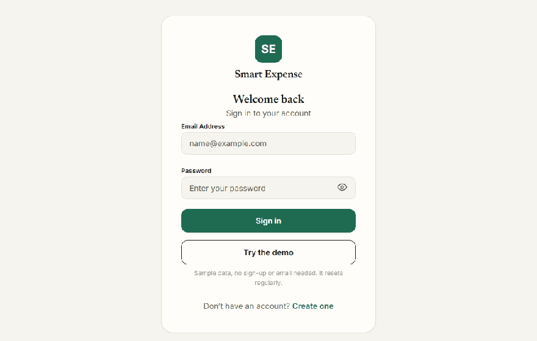
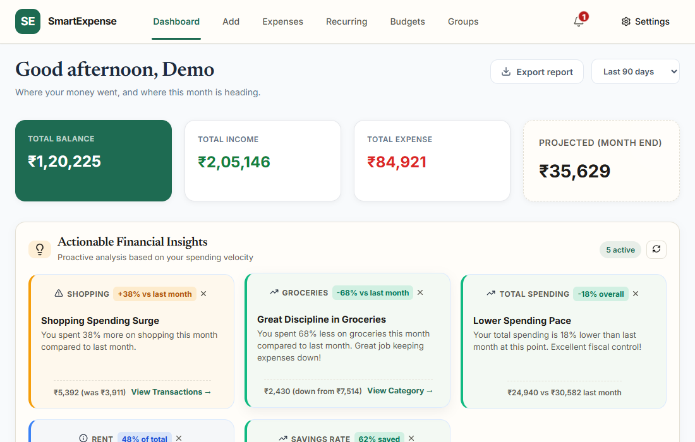
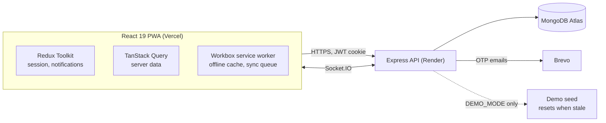

# Smart Expense System

[](https://github.com/AryaShah800/smart-expense-system/actions/workflows/backend-tests.yml)

A full-stack expense tracker with email-verified sign-up, budgets, recurring transactions, shared group expenses and an installable offline-capable PWA.

**[Live demo](https://smart-expense-system.vercel.app)** · The API runs on Render's free tier, so the first request after a quiet period can take up to a minute while it wakes.

## Screenshots





## Features

- Email OTP sign-up with resend and edit-email, JWT sessions, bcrypt password hashing
- Income and expense tracking with categories, search and filters
- Budgets and recurring transactions processed on a schedule
- Groups: shared expenses, member invitations, settlements and live notifications over Socket.IO
- Dashboard charts (Recharts) and PDF report export
- Light and dark themes, currency setting, mobile layout
- Installable PWA: Workbox service worker generated by vite-plugin-pwa (NetworkFirst API cache, background-sync queue)

## Tech stack

| Layer | Technology |
| --- | --- |
| Frontend | React 19, TypeScript (strict), Vite, Redux Toolkit (session and notifications), TanStack Query (server data), React Router 7, Tailwind CSS 4, Recharts, Socket.IO client, Sentry |
| Backend | Node.js, Express, Mongoose, Socket.IO |
| Database | MongoDB Atlas |
| Email | Brevo transactional API |
| Hosting | Vercel (frontend), Render (API) |
| Tests | Node test runner + supertest on an in-memory MongoDB (111 API tests), Vitest + React Testing Library (58 client tests), Playwright (6 e2e specs) |
| CI | GitHub Actions: backend tests and `npm audit`; client lint, type check, tests and build; daily API health check |

## Architecture



Routes live in `backend/routes`, request handling in `backend/controllers`, Mongoose schemas in `backend/models`, and auth middleware in `backend/middlewares`. Group endpoints check membership on every request; `backend/tests/group-authorization.test.js` covers those rules.

## Run locally

Prerequisites: Node.js 22+ and a MongoDB connection string (a free Atlas cluster works).

```bash
# 1. API
cd backend
cp .env.example .env        # fill in MONGO_URI, JWT_SECRET, BREVO_API_KEY
npm ci
npm run dev                 # http://localhost:7000

# 2. Frontend (new terminal)
cd client
cp .env.example .env
npm ci
npm run dev                 # http://localhost:5173
```

Sign-up sends an OTP email through Brevo, so `BREVO_API_KEY` and a verified sender are required to create accounts.

## Demo mode

Set these to let visitors try the app without signing up (off by default):

| Where | Variable | Value |
|---|---|---|
| API (Render) | `DEMO_MODE` | `true` |
| API (Render) | `DEMO_RESET_MINUTES` | optional, default `30` |

When on, the login page shows **Try the demo** (the client asks `GET /api/users/demo-status`). `POST /api/users/demo-login` signs into a seeded sandbox user with six months of sample data, budgets, recurring items and two groups. Guards, each covered by `backend/tests/demo-mode.test.js`: off unless `DEMO_MODE=true`; demo accounts cannot use password login; the demo user cannot change email or password; no email is sent for demo addresses; data is rebuilt on login when older than `DEMO_RESET_MINUTES`; the endpoint is rate limited (10 per 15 minutes per IP).

## Tests

```bash
cd backend && npm test
cd client && npm test       # Vitest + React Testing Library
cd client && npm run typecheck
```

### Client state

Redux Toolkit holds the session (the `auth` slice, whose session check signs out only on a 401 so a cold-starting API does not log anyone out) and the socket-fed notifications. Server data (transactions, groups, budgets, recurring schedules, insights) lives in TanStack Query: mutations invalidate the affected queries, socket events invalidate group and invitation queries, and the whole cache is cleared when the signed-in user changes.

## End-to-end tests

```bash
cd e2e && npm ci && npx playwright install chromium
npx playwright test   # starts the API on an in-memory MongoDB with DEMO_MODE=true, and the Vite client
```

Set `E2E_CHANNEL=msedge` (or `chrome`) to reuse an installed browser instead of downloading Chromium.

## Run everything with Docker

```bash
docker compose up --build            # app on http://localhost:8080, API on :7000, MongoDB included
```

The web container serves the built client with nginx and proxies `/api` to the API. Sign-up sends its OTP through the
Brevo HTTP API, so put `BREVO_API_KEY` (and a `JWT_SECRET`) in a `.env` file next to `docker-compose.yml`. Compose is
for local use: it falls back to a placeholder `JWT_SECRET` and runs the API in development mode. Do not deploy it as is.

## Load testing

`perf/` has a k6 script and instructions for a user with 50,000 transactions. The dashboard endpoint now reads the two-month window with one `$facet` aggregation instead of three reads plus in-memory summing; results and method are in [perf/README.md](perf/README.md).

## Deployment

See [docs/DEPLOYMENT.md](docs/DEPLOYMENT.md).

## What I'd do next

- Add tests for auth, transactions and budgets (only group authorization is covered today)
- Move the JWT from `localStorage` to an `httpOnly` cookie end to end
- Add rate limiting on sign-up and OTP endpoints


## License

MIT. See [LICENSE](LICENSE).
