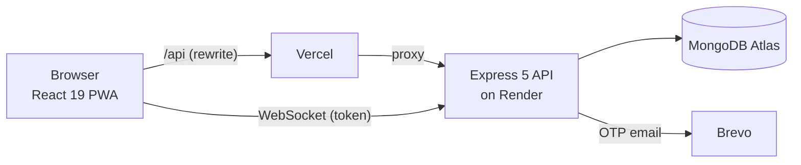

# Smart Expense System

A personal and group finance tracker built as an installable PWA. Track income and expenses, set budgets, automate recurring transactions, split costs with friends and settle up, and get live notifications.

> **Live demo:** <!-- TODO: replace with the Vercel production URL --> `https://YOUR-APP.vercel.app`
> **Demo login:** `demo@smartexpense.app` / `Demo@1234` (sample data, resets periodically). The API runs on a free Render instance, so the first request after idle can take up to a minute to wake it.

## Features

- **Transactions and categories:** income and expense tracking with default and custom categories.
- **Budgets:** per-category limits with status against actual spending.
- **Recurring transactions:** daily, weekly, monthly or yearly items, processed automatically; pause and resume.
- **Group expenses:** equal, exact and percentage splits, balances per member, settle-up payments, invite by code or invitation.
- **Reports and insights:** dashboard charts, spending insights and monthly PDF export.
- **Real-time notifications:** Socket.io, authenticated per user.
- **PWA:** installable, with offline caching and background sync for queued changes.
- **Email verification:** OTP sent on signup.

## Architecture



- The client calls `/api/*` on its own domain; `client/vercel.json` rewrites that to the Render API, so the auth cookie is first-party.
- Vercel cannot proxy WebSockets, so the socket connects straight to the API using a 2-minute token from `GET /api/users/socket-token`.

## Tech stack

| Layer | Tools |
| --- | --- |
| Client | React 19, TypeScript (strict), TanStack Query, Vite 7, React Router 7, Recharts, jsPDF, Socket.io client, vite-plugin-pwa (Workbox) |
| API | Node 22, Express 5, Mongoose 8, Socket.io |
| Data | MongoDB Atlas |
| Security | JWT in an `httpOnly` cookie, bcrypt, helmet, express-rate-limit, per-user socket rooms |
| Tests | Supertest + mongodb-memory-server (API), Vitest + React Testing Library (client) |
| CI | GitHub Actions (backend tests and `npm audit`, client lint, type check, tests and build, daily health ping) |

## Security notes

- The session JWT lives only in an `httpOnly` cookie, never in `localStorage` or a response body.
- Socket connections must present a valid token; the server decides which room a socket joins.
- Login, signup and OTP endpoints are rate limited (5 attempts per 15 minutes per IP and email).
- The debug OTP route does not exist unless `ENABLE_DEBUG_OTP=true`.
- Set `ALLOWED_ORIGINS` in production to restrict CORS to your own domain.

## Run locally

Requires Node 22+ and a MongoDB connection string (a free Atlas cluster works).

```bash
# API
cd backend
cp .env.example .env     # fill in MONGO_URI, JWT_SECRET, BREVO_API_KEY
npm install
npm run dev              # http://localhost:7000

# Client (second terminal)
cd client
cp .env.example .env
npm install
npm run dev              # http://localhost:5173
```

Sample data: `npm run seed:demo` in `backend/` creates the demo account (safe on any database; it only touches the demo users). Without email set up, add `ENABLE_DEBUG_OTP=true` to `backend/.env` for local testing and read an OTP from `GET /api/users/debug/otp?email=...`.

## Tests

```bash
cd backend
npm test                # 100+ integration tests: Supertest against an in-memory MongoDB
npm run test:coverage   # same, with a coverage report; fails under 70% line coverage
```

```bash
cd client
npm test                # 70+ Vitest + React Testing Library tests
npm run typecheck       # tsc --noEmit (strict)
```

The first backend run downloads a MongoDB binary for `mongodb-memory-server` (cached afterwards). CI runs the backend tests with coverage, `npm audit`, and a client lint, type check, tests and build.

## Performance and accessibility

Lighthouse 12 against the production build (`vite preview`) with the seeded demo account, mobile emulation (4x CPU slowdown, slow 4G) unless noted. Desktop numbers use Lighthouse's desktop preset.

| Page | Performance (mobile / desktop) | Accessibility | Best practices | SEO |
| --- | --- | --- | --- | --- |
| Login, Signup | 98 / 100 | 100 | 100 | 100 |
| Dashboard | 85 / 100 | 100 | 100 | 100 |
| Expenses | 96 / 100 | 100 | 100 | 100 |
| Budgets | 96 / 100 | 100 | 100 | 100 |
| Groups | 100 / 100 | 100 | 100 | 100 |
| Recurring | 100 / 100 | 100 | 100 | 100 |
| Add transaction, Settings | 99-100 / 100 | 100 | 100 | 100 |

What changed:

- Routes are lazy-loaded and jsPDF is imported only when someone exports, so the first-load script went from one 1.29 MB bundle (401 kB gzip) to a 401 kB entry chunk (131 kB gzip) plus per-page chunks. The PDF libraries (about 800 kB) are kept out of the service worker precache (1.6 MB down to 925 KiB).
- Only the active dashboard layout is mounted; it used to render both the desktop and mobile layouts and draw every chart twice.
- Brand, success, danger and muted colours were darkened to meet WCAG AA contrast (the dark theme has its own lighter status colours); text is never smaller than 12px.
- Every form control has an associated label, headings no longer skip levels, and the shared modal is a real dialog (role, `aria-modal`, focus moved in and restored, Tab trapped, Escape closes).
- `robots.txt`, a meta description and a proper page title.

The mobile dashboard is the one page under 90: with 4x CPU throttling the Recharts code costs about 570 ms of blocking time. On a desktop-class CPU it scores 100.

CI runs Lighthouse CI on the public pages (`client/lighthouserc.cjs`, minimum 0.9 in every category). The pages behind login need a backend, so they are audited manually against a local stack.

## Project structure

```
backend/
  controllers/   request handlers          routes/        Express routers
  middlewares/   auth, rate limits, socket auth
  models/        Mongoose schemas          scripts/       seed and load scripts
  tests/         node:test suites
client/
  src/pages/     route screens            src/components/  UI and charts
  src/api/       axios + socket clients   src/context/     auth state
```

## Deployment

See [DEPLOYMENT.md](DEPLOYMENT.md).
